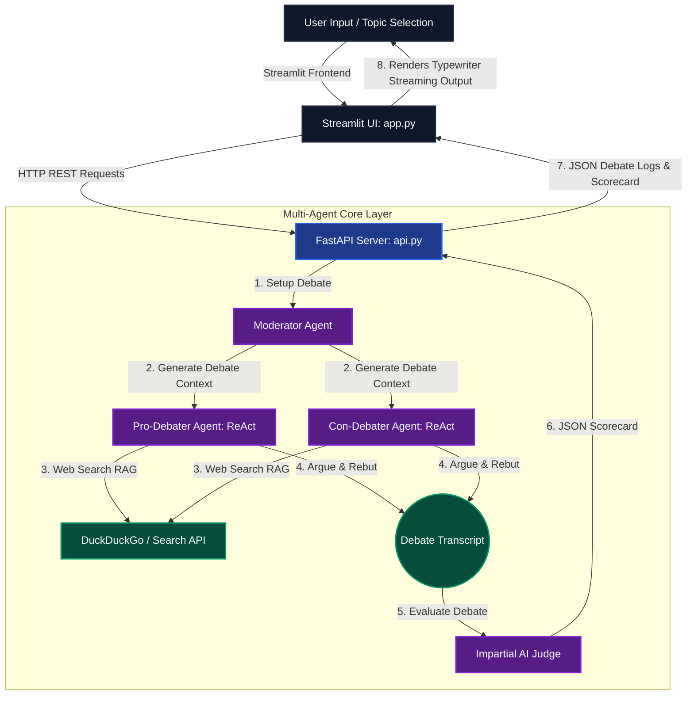

#  Multi-Agent Debate System

### *An Autonomous, RAG-Enhanced AI Debate Platform*


---

## Executive Summary

This project is a fully autonomous **Multi-Agent System (MAS)** where AI agents engage in structured, logical debates on complex topics. Unlike standard chatbots, these agents possess **agency**: they plan their arguments, research real-time data from the web to prevent hallucinations, and are evaluated by an impartial AI Judge based on strict logical scoring criteria.

The system has been engineered into a full-stack application with a **FastAPI** backend, a **Streamlit** frontend, and industry-grade **MLOps** logging, all orchestrated via **Docker**.

---

## ️ System Architecture

The system follows a modular **Hub-and-Spoke** architecture, decoupling the agent logic from the user interface.



### **Core Components**
1.  **The Agents (Logic Layer)**:
    * **Debaters (Pro/Con):** Utilize the **ReAct Pattern** (Reason + Act). They analyze the opponent's argument, formulate a research plan, execute web searches (RAG), and synthesize a response.
    * **The Moderator:** Dynamically generates balanced topics and manages the debate flow.
    * **The Judge:** A specialized agent tuned for **Result-Oriented Evaluation**. It parses the full transcript and outputs a structured JSON Scorecard rating Logic, Evidence, and Persuasion.

2.  **The MLOps Layer (Observability)**:
    * **Structured Logging:** Captures detailed execution traces (Input -> Plan -> Tool Output -> Response).
    * **Audit Trails:** Saves every debate as a timestamped transcript in `logs/` for post-mortem analysis.
    * **Self-Healing:** The system detects tool failures (e.g., Search API timeouts) and degrades gracefully without crashing.

3.  **The Deployment Layer**:
    * **FastAPI:** Exposes the debate logic as a RESTful API.
    * **Streamlit:** Provides an interactive UI with simulated "Typewriter" streaming.
    * **Docker Compose:** Orchestrates the entire stack with isolated networking and custom port mapping.

---

## The Engineering Journey: From Script to System

This section documents the complete technical evolution of the project, detailing every phase of development, the specific problems encountered, and the engineering solutions implemented.

### 🟢 Phase 1: The "Hello World" of Agents (MVP)
**Goal:** Create two AI agents that can talk to each other.

#### 1.1 The Initial Concept
We started with a simple Python script using the `openai` API. We defined two basic system prompts:
* **Agent A:** "You are a supporter of [Topic]."
* **Agent B:** "You are an opponent of [Topic]."

#### 1.2 The Implementation
We used a basic `while` loop to pass strings back and forth.
```python
# Pseudo-code of Version 1
while round < 3:
    response_a = client.chat.completions.create(messages=[...])
    print(f"Agent A: {response_a}")
    
    response_b = client.chat.completions.create(messages=[...])
    print(f"Agent B: {response_b}")

```

#### 1.3 The Problems

1. **Amnesia:** The agents didn't remember what was said in the previous turn because we weren't saving the `conversation_history`.
2. **Repetition:** They kept making the same introductory points over and over.
3. **Hallucinations:** Without access to the internet, they made up fake statistics to support their arguments.

---

### 🟡 Phase 2: Intelligence & Grounding (The "ReAct" Upgrade)

**Goal:** Make the agents smarter and factually accurate.

#### 2.1 Implementing Memory

We introduced a shared list called `conversation_history`.

* Every time an agent spoke, we appended `{"role": "assistant", "content": "..."}` to this list.
* Before the next agent spoke, we fed them the entire list so they could "react" to the opponent.

#### 2.2 Fixing Hallucinations (RAG)

We implemented the **ReAct Pattern (Reason + Act)**. Instead of just speaking, the agent now follows a strict 3-step process:

1. **Plan:** The agent asks itself, "Do I need to search for facts?"
2. **Act (Tool Use):** If yes, it uses the `DuckDuckGo` search tool to find real-world data.
3. **Speak:** It generates an argument citing the specific sources it found.

#### 2.3 The "Moderator" Agent

To stop the debate from being chaotic, we added a third agent: **The Moderator**.

* **Role:** Dynamically generates balanced, random topics (e.g., "AI Rights", "CRISPR Ethics") and sets the stage before the debaters begin.

---

### 🟠 Phase 3: The Judge & Evaluation Tuning

**Goal:** An objective way to decide who won.

#### 3.1 The "Nice Judge" Problem

Initially, our Judge agent was too polite. It would often declare a "Tie" or say "Both sides made good points" because it was prioritizing safety/ethics over scoring.

#### 3.2 The Solution: Result-Oriented Tuning

We rewrote the Judge's system prompt to be **strict and analytical**.

* **New Instruction:** "You are a ruthless logic analyzer. Ignore ethical pleasantries. Score based strictly on: 1. Logical Consistency, 2. Evidence Usage, 3. Rebuttal Effectiveness."
* **Structured Output:** We forced the Judge to output **JSON** instead of text.
* *Before:* "I think Pro won..."
* *After:* `{"winner": "Pro", "scores": {"Pro": {"logic": 9}, "Con": {"logic": 7}}}`


---

### 🔵 Phase 4: MLOps & Observability (The "Enterprise" Upgrade)

**Goal:** Robust error handling and audit trails.

#### 4.1 From Print to Logging

We replaced all `print()` statements with a professional `logging` system.

* **Why?** In production, you can't see the console. You need files.
* **Implementation:** We created `utils/logger.py` to save every debate to `logs/debate_[TIMESTAMP].txt`.

#### 4.2 Self-Healing Code

We noticed the Search Tool would sometimes crash (raise `KeyError`) if the internet was slow.

* **The Fix:** We wrapped the tool execution in `try/except` blocks.
* **The Result:** If a search fails, the agent logs a warning: *"Search failed, relying on internal knowledge"*—and the system keeps running instead of crashing.

---

### 🟣 Phase 5: Full-Stack Deployment

**Goal:** Move from a command-line script to a real application.

#### 5.1 The Backend (FastAPI)

We extracted the logic into `api.py`.

* Created endpoints: `POST /run_debate` and `GET /health`.
* Enabled **Swagger UI**: Allows developers to test the agents via a web interface at `localhost:8003/docs`.

#### 5.2 The Frontend (Streamlit)

We built `app.py` to give users a beautiful interface.

* **Visuals:** Blue bubbles for Pro, Red for Con.
* **UX Upgrade:** Implemented a **"Typewriter Effect"** (Simulated Streaming) so the text appears word-by-word, mimicking a real human debate.
* **Controls:** Added sliders for "Typing Speed" and "Number of Rounds."

#### 5.3 Containerization (Docker)

We packaged the whole system into Docker containers to solve the "It works on my machine" problem.

* **Challenge:** Port conflicts with existing projects (Port 8000/8001 were busy).
* **Solution:** We mapped the internal ports to **8003** (API) and **8503** (UI) in `docker-compose.yml`.

---
## ️ Tech Stack

| Component | Technology | Purpose |
| --- | --- | --- |
| **LLM Engine** | OpenAI GPT-4o-mini | Core reasoning and text generation. |
| **Backend** | Python 3.12, FastAPI | API endpoints and agent orchestration. |
| **Frontend** | Streamlit | Interactive web interface with real-time updates. |
| **Search Tool** | DuckDuckGo Search (ddgs) | Real-time web retrieval for evidence. |
| **Containerization** | Docker & Docker Compose | Isolation and consistent deployment. |
| **Observability** | Python Logging | Structured logging and file persistence. |

---

## Installation & Usage

### **Prerequisites**

* Docker & Docker Desktop installed.
* An OpenAI API Key.

### **1. Configuration**

Create a `.env` file in the root directory:

```bash
OPENAI_API_KEY=sk-your-key-here

```

### **2. Run with Docker (Recommended)**

This will spin up both the API and the UI in isolated containers.

```bash
docker-compose up --build

```

*Wait for the logs to show "Uvicorn running..." and "Streamlit...".*

### **3. Access the Application**

* **Frontend (Visual Debate):** Open [http://localhost:8503](https://www.google.com/search?q=http://localhost:8503)
* **Backend (API Docs):** Open [http://localhost:8003/docs](https://www.google.com/search?q=http://localhost:8003/docs)

---

## Project Structure

```text
Multi_Agent_Debating_System/
├── agents/                 # The "Brain" of the system
│   ├── debater.py          # ReAct Agent (Plan -> Research -> Speak)
│   ├── judge.py            # Evaluation Logic (JSON Parsing)
│   ├── moderator.py        # Flow Control
│   ├── topic_selector.py   # Dynamic Topic Generation
│   └── prompts.py          # Centralized System Prompts
├── utils/                  # Shared Utilities
│   ├── logger.py           # MLOps Logging System
│   └── tools.py            # Search Tool Implementation
├── logs/                   # Generated Audit Trails (Git-ignored)
├── api.py                  # FastAPI Backend Entrypoint
├── app.py                  # Streamlit Frontend Entrypoint
├── config.py               # Configuration & Validation
├── docker-compose.yml      # Orchestration Config
└── Dockerfile              # Container Definition

```

## API Reference

The system exposes a RESTful API for integration.

**Endpoint:** `POST /run_debate`

**Payload:**

```json
{
  "topic": "Is AI consciousness possible?",
  "rounds": 3
}

```

**Response:**

```json
{
  "topic": "Is AI consciousness possible?",
  "transcript": [ ... ],
  "verdict": {
    "winner": "Con",
    "scores": { "Pro": {"logic": 7}, "Con": {"logic": 9} }
  }
}

```